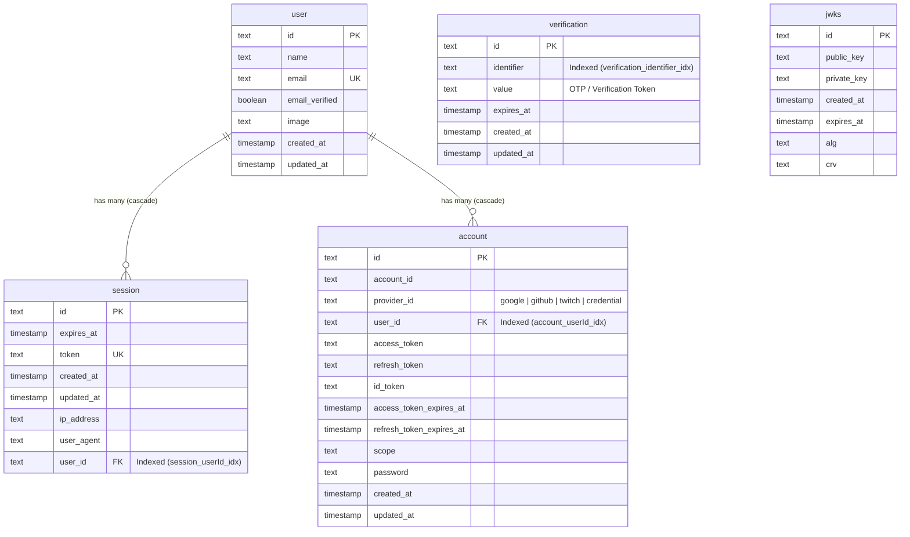
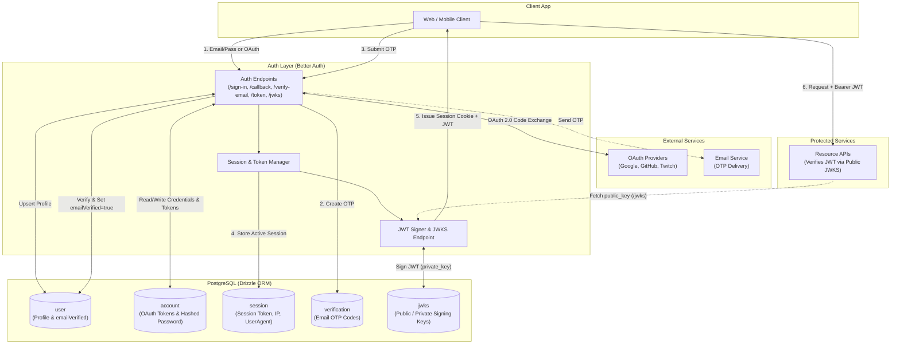

# Architecture Design

1. Auth Layer:

The Project used Better Auth with 4 Auth Options

- Google OAuth
- Github OAuth
- Twitch OAuth (configure TWITCH_CLIENT_ID/SECRET to enable)
- Email & OTP Code Logi

